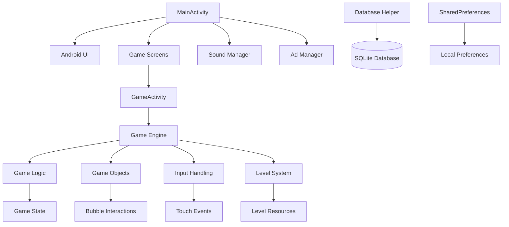
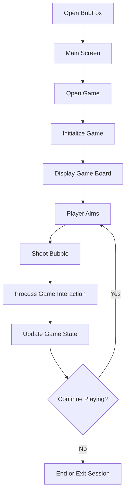

 <div align="center">

# BubFox 🫧

<p><b>A 2D Android bubble-shooter game focused on interactive gameplay, colorful bubbles, level progression and a lightweight mobile experience.</b></p>

<p>
Android Application · Java · Android SDK · Custom Game Engine · SQLite · Google AdMob
</p>

<br>

<p>
  <a href="https://github.com/allknowledge34/BubFox">
    
  </a>
</p>

<br>

<p>
  
  
  
  
  
</p>

<br><br>

<table align="center" width="85%">
<tr>
<td align="center">

<h2>Meet BubFox</h2>

<p>
A colorful bubble-shooter game built for Android,<br>
combining interactive shooting mechanics with a playful game experience.
</p>

</td>
</tr>
</table>

<br>

<sub><em>BubFox aims to deliver an engaging mobile gaming experience through lightweight Android development and reusable gameplay systems.</em></sub>

</div>

---

## 📑 Table of Contents

<table width="100%">
<tr>
<td valign="top">

1. [Overview](#1-overview)
2. [Core Gameplay](#2-core-gameplay)
3. [Architecture](#3-architecture)
4. [Gameplay Flow](#4-gameplay-flow)
5. [Key Features](#5-key-features)
6. [Level System](#6-level-system)

</td>
<td valign="top">

7. [Game Mechanics](#7-game-mechanics)
8. [Project Structure](#8-project-structure)
9. [Tech Stack](#9-tech-stack)
10. [Quick Start](#10-quick-start)
11. [Build](#11-build)
12. [Testing](#12-testing)

</td>
<td valign="top">

13. [Data & Privacy](#13-data--privacy)
14. [Advertising](#14-advertising)
15. [Development Principles](#15-development-principles)
16. [Roadmap](#16-roadmap)
17. [Project Status](#17-project-status)
18. [Author](#18-author)

</td>
</tr>
</table>

---

## 1. Overview

**BubFox** is a 2D bubble-shooter game for Android, developed using Java and the Android SDK.

The project uses a custom game-engine implementation alongside Android application components to deliver gameplay, screen navigation, sound, level management and supporting game systems.

The application package is:

```text
com.sachin.bubfox
```

BubFox is designed as a native Android application, with game resources and supporting components organized within a standard Android Studio project.

### Core Idea

```text
OPEN GAME
    ↓
EXPLORE GAME SCREENS
    ↓
START GAMEPLAY
    ↓
AIM AND SHOOT
    ↓
INTERACT WITH BUBBLES
    ↓
PROGRESS THROUGH THE GAME
```

---

## 2. Core Gameplay

BubFox is built around the bubble-shooter genre.

The typical gameplay experience revolves around aiming and launching bubbles to interact with the game board and progress through the available gameplay.

Core gameplay interactions may include:

- Aiming and shooting bubbles using touch controls.
- Interacting with the bubble board.
- Navigating available game levels.
- Using the game's existing gameplay mechanics and controls.
- Progressing through the game.
- Experiencing game audio and visual feedback.

The exact objectives, special bubbles, boosters and level rules depend on the mechanics implemented in the current project.

---

## 3. Architecture

BubFox follows a native Android project structure with Java-based application components, game-engine classes, resource files and supporting systems.

The following diagram represents the high-level application architecture. It is a conceptual overview; the exact call relationships depend on the implementation.



### Main Components

| Component | Responsibility |
|---|---|
| `MainActivity` | Main Android activity and application entry point |
| `GameActivity` | Game-related activity and gameplay integration |
| `GameEngine` | Core game-engine processing |
| `GameController` | Gameplay coordination and state-related operations |
| `ProductAdapter` | Adapter for the product or item list used by the application |
| `DatabaseHelper` | SQLite database access and persistence |
| `AdManager` | Advertising-related operations |
| `SoundManager` | Game audio and sound-effect handling |
| `LivesTimer` | Lives-related timer operations |
| `WheelDialog` | Wheel-related dialog functionality, if enabled in the current build |
| `WinDialog` | Win-related dialog functionality |

Component responsibilities are summarized from the project structure; verify the current source for implementation details.

---

## 4. Gameplay Flow

The following flow illustrates a typical bubble-shooter session.



### Gameplay Processing

The game engine is responsible for processing the gameplay according to its existing implementation.

Important areas include:

- Input handling.
- Game-object updates.
- Gameplay state transitions.
- Rendering and visual updates.
- Level and session management.
- Interaction between Android lifecycle events and gameplay.

---

## 5. Key Features

<table width="100%">
<tr>
<td width="50%" valign="top">

<b>🫧 Bubble-Shooter Gameplay</b><br>
A 2D bubble-shooter experience designed for Android devices.

<br><br>

<b>🎮 Interactive Controls</b><br>
Touch-based interaction with the game interface and gameplay elements.

<br><br>

<b>🧩 Game Systems</b><br>
Organized Java components for gameplay logic and supporting systems.

<br><br>

<b>🗺️ Level Management</b><br>
Dedicated level-related components and resources.

</td>
<td width="50%" valign="top">

<b>🔊 Audio Support</b><br>
Sound-management components for the game's audio experience.

<br><br>

<b>💾 Local Persistence</b><br>
SQLite-based storage for data handled by the local database layer.

<br><br>

<b>📱 Native Android</b><br>
Built as an Android application using Java and Android resources.

<br><br>

<b>📢 Advertising Integration</b><br>
Google AdMob integration for supported advertising experiences.

</td>
</tr>
</table>

> Feature availability and behavior should be confirmed against the current implementation before a production release.

---

## 6. Level System

BubFox contains dedicated level-related components within its Java source structure.

The level system is responsible for the level-related functionality implemented in the current project.

### Level-Related Source Package

```text
app/src/main/java/com/sachin/bubfox/level/
```

### Level System Responsibilities

- Managing level-related data and operations.
- Integrating level information with gameplay.
- Supporting transitions between the relevant game screens.
- Working with the game engine where required.

The exact level format, progression rules and number of available levels depend on the resources included in the project.

---

## 7. Game Mechanics

BubFox uses a custom game-engine structure to support its 2D gameplay.

### Game Engine

The game-engine package contains components responsible for the processing required by the game's runtime.

```text
app/src/main/java/com/sachin/bubfox/game_engine/
```

### Gameplay Components

```text
app/src/main/java/com/sachin/bubfox/game/
```

### Supporting Systems

```text
app/src/main/java/com/sachin/bubfox/database/
app/src/main/java/com/sachin/bubfox/item/
app/src/main/java/com/sachin/bubfox/level/
app/src/main/java/com/sachin/bubfox/sound/
app/src/main/java/com/sachin/bubfox/timer/
app/src/main/java/com/sachin/bubfox/ui/
```

These packages separate different areas of the application and help keep related functionality organized.

Specific mechanics such as special bubbles, power-ups, collision rules and level objectives should be documented in detail after verifying their actual implementation.

---

## 8. Project Structure

The project follows an Android Studio structure using Java source files, Android resources, assets and Gradle build scripts.

```text
BubFox/
│
├── app/
│   ├── src/
│   │   ├── main/
│   │   │   ├── java/
│   │   │   │   └── com/
│   │   │   │       └── sachin/
│   │   │   │           └── bubfox/
│   │   │   │               ├── database/
│   │   │   │               ├── game/
│   │   │   │               ├── game_engine/
│   │   │   │               ├── item/
│   │   │   │               ├── level/
│   │   │   │               ├── sound/
│   │   │   │               ├── timer/
│   │   │   │               ├── ui/
│   │   │   │               ├── AdManager.java
│   │   │   │               └── MainActivity.java
│   │   │   │
│   │   │   ├── assets/
│   │   │   ├── res/
│   │   │   └── AndroidManifest.xml
│   │   │
│   │   ├── test/
│   │   └── androidTest/
│   │
│   └── build.gradle.kts
│
├── gradle/
│   └── libs.versions.toml
│
├── build.gradle.kts
├── settings.gradle.kts
├── gradle.properties
├── gradlew
├── gradlew.bat
└── README.md
```

*Note: This is a high-level structure based on the project layout. Some files and directories may differ in your local checkout.*

---

## 9. Tech Stack

| Layer | Technology |
|---|---|
| Language | Java |
| Platform | Android |
| Application ID | `com.sachin.bubfox` |
| UI | Android Views and XML resources |
| Game Engine | Custom Java game-engine implementation |
| Build System | Gradle |
| Build Scripts | Kotlin DSL |
| Local Database | SQLite |
| Local Preferences | SharedPreferences, where used |
| Advertising | Google AdMob |
| IDE | Android Studio |
| Version Control | Git and GitHub |

The exact SDK versions are defined by the Gradle configuration in the project.

---

## 10. Quick Start

### Clone the Repository

```bash
git clone https://github.com/allknowledge34/BubFox.git
cd BubFox
```

If the repository is private or the URL changes, use the repository URL configured for your GitHub account.

### Open the Project

1. Open Android Studio.
2. Select **Open** and choose the BubFox project directory.
3. Allow Gradle synchronization to complete.
4. Ensure the required Android SDK components are installed.
5. Connect an Android device or configure an emulator.
6. Select the `app` run configuration.
7. Click **Run** to install and launch the application.

### Requirements

```text
Android Studio
Compatible JDK configured for the project
Android SDK required by Gradle
Gradle wrapper included with the project
Android emulator or physical Android device
```

Use the JDK and SDK versions specified by the project's Gradle configuration rather than assuming a particular version.

---

## 11. Build

### Debug Build

On macOS or Linux:

```bash
./gradlew assembleDebug
```

On Windows:

```powershell
.\gradlew.bat assembleDebug
```

### Run Tests

```bash
./gradlew test
```

### Run Android Lint

```bash
./gradlew lint
```

### Clean Build

```bash
./gradlew clean assembleDebug
```

### Release Android App Bundle

```bash
./gradlew bundleRelease
```

A successful Gradle task alone does not guarantee that the resulting release is correctly signed or ready for Google Play.

### Release Signing

Release signing must be configured securely before distributing a production build.

Never commit the following to GitHub:

```text
*.jks
*.keystore
keystore.properties
local.properties
Passwords
Signing credentials
Private keys
Unprotected production secrets
```

Use a secure, local signing configuration or environment variables. Keep actual credentials outside version control.

---

## 12. Testing

Before preparing a release, verify the following areas.

### Application

- [ ] Application launches successfully.
- [ ] Main screen displays correctly.
- [ ] Navigation between screens works.
- [ ] The game opens without crashing.
- [ ] Back navigation behaves correctly.
- [ ] The application resumes correctly after backgrounding.

### Gameplay

- [ ] Touch controls respond correctly.
- [ ] Bubble shooting behaves as expected.
- [ ] Game interactions update the board correctly.
- [ ] Level transitions work.
- [ ] Win and loss flows work, where applicable.
- [ ] Restarting gameplay works.
- [ ] Repeated gameplay sessions do not cause crashes.

### Persistence

- [ ] Relevant game data is saved correctly.
- [ ] Saved progress survives application restart.
- [ ] Database operations handle errors safely.
- [ ] Repeated updates do not create incorrect or duplicate progress.

### Audio and Ads

- [ ] Audio starts and stops correctly.
- [ ] Audio behaves correctly during pause and resume.
- [ ] Ad loading failures do not freeze gameplay.
- [ ] Rewarded ads grant rewards only when earned.
- [ ] Test advertisements are used during development.
- [ ] Production ad configuration is reviewed before launch.

### Release

- [ ] `./gradlew test` passes.
- [ ] `./gradlew lint` has no unresolved blocking issues.
- [ ] Debug build succeeds.
- [ ] Release build succeeds.
- [ ] Release signing is verified.
- [ ] Application ID is `com.sachin.bubfox`.
- [ ] Privacy policy and Data safety declarations are complete.
- [ ] Google Play internal testing is completed.

---

## 13. Data & Privacy

BubFox includes a local database layer and may use third-party advertising services.

### Local Storage

The project includes SQLite-related components for local database operations.

```text
SQLite
Android application resources
Local assets
SharedPreferences, where used
```

The exact information stored locally should be confirmed by inspecting the current database schema and application code.

### Third-Party Services

The project integrates Google Mobile Ads and may use the Google User Messaging Platform for consent management, depending on the configured dependencies and implementation.

Third-party SDKs may process information under their own documented policies and applicable configuration.

### Privacy Policy

A public privacy policy must accurately describe the application's actual data practices and the behavior of its integrated SDKs.

Before publishing:

- Review all SDKs and their data collection practices.
- Verify advertising and consent configuration.
- Complete the Google Play Data safety form accurately.
- Provide a valid public privacy-policy URL.
- Ensure the policy matches the released application.

Do not assume that the application collects no data merely because its core gameplay can run locally.

---

## 14. Advertising

BubFox integrates Google AdMob for advertising-related functionality.

### Development

Use Google's official test ad identifiers during development and testing.

### Production

Before production release:

- Configure the correct production AdMob app and ad-unit identifiers.
- Verify the intended audience and applicable advertising requirements.
- Implement the required consent flow for applicable regions.
- Test ad load failures and dismissal behavior.
- Verify reward callbacks and prevent duplicate rewards.
- Complete the relevant privacy and advertising disclosures.

Never click your own live advertisements while testing.

Do not ship sample test identifiers as production advertising credentials.

---

## 15. Development Principles

BubFox follows a focused approach to Android game development.

- Preserve the existing gameplay experience.
- Keep the application package consistent.
- Prefer small, maintainable changes.
- Avoid unnecessary dependencies.
- Avoid unnecessary Android permissions.
- Keep gameplay responsive.
- Handle Android lifecycle events safely.
- Manage database resources correctly.
- Keep ad failures from interrupting basic gameplay.
- Use automated tests where practical.
- Verify changes with real builds and device testing.
- Keep signing credentials outside version control.

---

## 16. Roadmap

### Game Development

- [x] Android application structure
- [x] Java-based game components
- [x] Game-engine package
- [x] Level-related components
- [x] Database-related components
- [x] Sound and timer components
- [ ] Complete gameplay regression testing
- [ ] Verify all level and progression behavior
- [ ] Finish gameplay polish
- [ ] Complete device compatibility testing

### Android Release

- [x] Production application ID selected
- [ ] Final automated test verification
- [ ] Resolve remaining lint issues
- [ ] Verify release signing
- [ ] Finalize production AdMob configuration
- [ ] Complete privacy and consent review
- [ ] Publish privacy policy
- [ ] Complete Google Play Data safety declarations
- [ ] Prepare store listing and screenshots
- [ ] Test signed Android App Bundle
- [ ] Complete internal testing
- [ ] Evaluate production release readiness

*Checklist items should be marked complete only after the corresponding work has actually been verified.*

---

## 17. Project Status

BubFox is an Android bubble-shooter project under development and release preparation.

The project contains Java-based application components, a game-engine package, level-related functionality, database integration, sound management and advertising-related components.

The current development focus is to validate gameplay, resolve remaining technical issues, verify third-party SDK configuration and complete the Android release workflow.

### Release Preparation Flow

```text
CODE REVIEW
     ↓
BUG FIXES
     ↓
AUTOMATED TESTING
     ↓
DEVICE TESTING
     ↓
PRIVACY & ADS REVIEW
     ↓
RELEASE SIGNING
     ↓
INTERNAL TESTING
     ↓
PRODUCTION READINESS REVIEW
```

The repository reflects the project state committed to GitHub. Release readiness should be determined from actual build results, testing evidence and the remaining external requirements.

---

## 18. Author

**Sachin Kumar**

B.Tech Computer Science & Engineering

<p>
  <a href="https://github.com/allknowledge34">
    
  </a>
</p>

---

<div align="center">

### BubFox 🫧

<p>Built with Java and Android.</p>

<a href="https://github.com/allknowledge34/BubFox">
  View Repository
</a>

</div>
